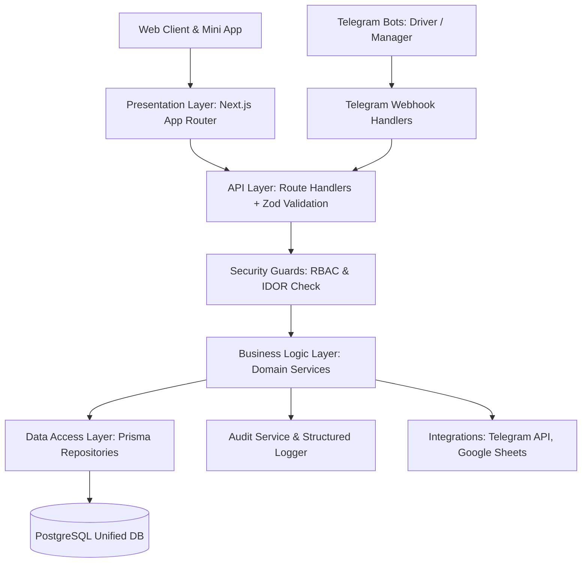

# AliBros Logistics — Архитектурная документация (Phase 1)

## 1. Архитектурная концепция

Система AliBros Logistics спроектирована как **модульный монолит (Modular Monolith)**.
Такой подход обеспечивает:
- **Единую точку истины**: одна база данных, исключающая рассинхронизацию между веб-кабинетом, Telegram-ботами водителей и админ-панелью.
- **Строгую изоляцию бизнес-логики**: каждый домен инкапсулирован в отдельном модуле и общается с другими через типизированные контракты и DTO.
- **Низкие операционные расходы**: отсутствие накладных расходов на оркестрацию микросервисов и межузловые сетевые задержки на начальном этапе.
- **Масштабируемость**: при росте нагрузки любой доменный модуль (`orders`, `notifications`, `delivery`) может быть вынесен в независимый микросервис без переписывания доменной модели.

---

## 2. Слои архитектуры

### 2.1. Presentation Layer (`app/`, `components/`)
- Отвечает за рендеринг пользовательского интерфейса (React Server Components и Client Components).
- **Инвариант**: React-компоненты не содержат прямой бизнес-логики и SQL-запросов; они обращаются к серверным Server Actions или Route Handlers.

### 2.2. API Layer (`app/api/`)
- Принимает HTTP-запросы и вебхуки Telegram.
- Выполняет валидацию входных данных через Zod-схемы.
- Форматирует стандартизированные ответы `ApiResponse<T>`.

### 2.3. Business Logic Layer (`modules/*/service.ts`)
- Инкапсулирует ключевые правила логистики: расчёт объёмно-весовых характеристик, переходы статусов заказа, назначение водителей, отправку системных событий.
- Полностью независим от веб-фреймворка.

### 2.4. Data Access Layer (`database/prisma.ts`, `modules/*/repository.ts`)
- Типизированный доступ к данным через Prisma Client.
- Инкапсуляция транзакционных операций (`$transaction`).

### 2.5. Infrastructure Layer (`lib/`, `integrations/`, `config/`)
- Безопасность: Argon2id (`lib/security/password.ts`), JWT (`lib/security/jwt.ts`), Telegram HMAC-SHA256 (`lib/security/telegram.ts`), Rate limiting (`lib/security/rate-limit.ts`).
- Структурированное логирование: Pino (`lib/logger.ts`).
- Внешние интеграции: Telegram Bot API (`integrations/telegram/`), Google Sheets (`integrations/google-sheets/`).

---

## 3. Каталог доменных модулей (`modules/`)

| Модуль | Ответственность |
| :--- | :--- |
| `auth` | Регистрация клиентов, аутентификация по логину/паролю и через Telegram `initData`, выпуск JWT токенов. |
| `users` | Управление учётными записями, ролями, статусами активности. |
| `clients` | Юридические профили селлеров (ИНН, реквизиты, склады по умолчанию). |
| `drivers` | Профили водителей, транспортные средства (грузоподъёмность, объём кузова), статус доступности. |
| `managers` | Профили операционных менеджеров, распределение по отделам. |
| `orders` | Создание заявок, валидация коробок и габаритов, генерация трек-номеров `ABL-YYYY-XXXXXX`, проверка прав доступа. |
| `warehouses` | Справочник складов приёмки маркетплейсов (WB Коледино, Электросталь, Ozon Хоругвино и др.). |
| `delivery` | Назначение водителей на заявки, маршрутизация, смена статусов доставки. |
| `order-history`| Неизменяемая история переходов статусов с фиксацией автора и комментариев. |
| `reports` | Агрегированные отчёты по объёмам, весу, статусам и финансам. |
| `notifications`| Очередь уведомлений (Telegram, In-App). |
| `telegram` | Связывание Telegram ID с пользователями системы, диспетчеризация ботов. |
| `integrations` | Хранение настроек внешних сервисов (Google Sheets, Webhooks). |
| `admin` | Административные операции, системные метрики и режим обслуживания. |
| `audit` | Сквозной неизменяемый журнал безопасности и мутаций данных. |

---

## 4. Нефункциональные требования (NFR)

1. **Производительность**:
   - Быстрый отклик API (p95 < 150ms).
   - In-memory rate limiting предотвращает DoS на уровне API.
2. **Надёжность и целостность**:
   - Связи внешних ключей и ограничения уникальности контролируются на уровне PostgreSQL.
   - Изменения статусов заказа и фиксация истории выполняются в единой транзакции БД.
3. **Безопасность**:
   - Серверный RBAC для 6 ролей.
   - Криптографическая валидация Telegram `initData` по HMAC-SHA256.
   - Защита от IDOR на уровне `assertOrderAccess`.
4. **Наблюдаемость**:
   - JSON-логирование в формате Pino с автоматическим скрытием (redact) паролей, токенов и персональных данных.
