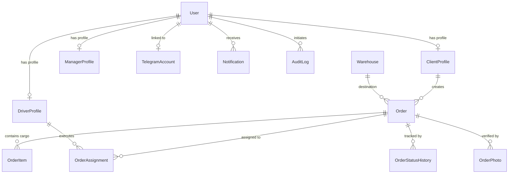
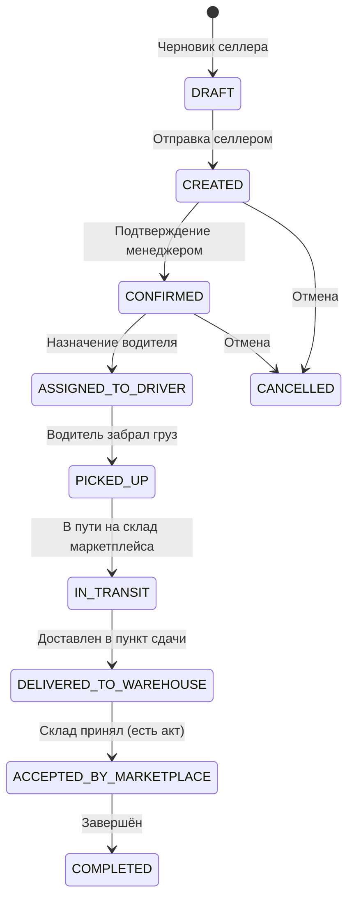

# AliBros Logistics — Документация базы данных (Phase 1)

## 1. Обзор архитектуры БД

База данных AliBros Logistics реализована на **PostgreSQL** под управлением **Prisma ORM**.
Схема спроектирована для работы в режиме высокой нагрузки с обеспечением ссылочной целостности и аудируемости.

### Ключевые требования схемы:
- **UUID v4**: первичные ключи всех сущностей генерируются как UUID (`@id @default(uuid())`).
- **Бизнес-номера заказов**: генерируются по стандарту `ABL-YYYY-XXXXXX` и имеют ограничение `@unique`.
- **Временные метки**: поля `createdAt` и `updatedAt` для контроля актуальности записей.
- **Индексация**: составные и одиночные B-Tree индексы на всех внешних ключах, статусах и поисковых полях.
- **Неизменяемый аудит**: раздельные таблицы для истории смены статусов (`order_status_history`) и аудита мутаций (`audit_logs`).

---

## 2. ER-диаграмма сущностей

---

## 3. Описание сущностей

### 3.1. `User` (Таблица `users`)
Центральная сущность аутентификации и идентификации.
- `id` (UUID): уникальный идентификатор.
- `email` (String, unique, optional): email для входа и уведомлений.
- `phone` (String, unique, optional): международный номер телефона.
- `passwordHash` (String, optional): Argon2id хеш.
- `role` (UserRole enum): `SUPER_ADMIN`, `ADMIN`, `MANAGER`, `ACCOUNTANT`, `DRIVER`, `CLIENT`.
- `isActive` (Boolean): признак активности аккаунта.
- `isVerified` (Boolean): верифицирован ли контакт (телефон/email).
- `lastLoginAt` (DateTime, optional): время последней успешной авторизации.

### 3.2. `ClientProfile` (Таблица `client_profiles`)
Профиль клиента (селлера маркетплейсов).
- `userId` (UUID, unique): связь 1-to-1 с `User`.
- `companyName` (String): коммерческое наименование бренда / ИП / ОсОО.
- `legalName` (String, optional): юридическое наименование.
- `inn` (String, unique, optional): ИНН организации.
- `contactPerson`, `contactPhone`, `contactEmail`: операционные контакты.
- `defaultWarehouseId` (UUID, optional): предпочтительный склад сдачи.

### 3.3. `DriverProfile` (Таблица `driver_profiles`)
Профиль водителя-экспедитора.
- `userId` (UUID, unique): связь 1-to-1 с `User`.
- `fullName` (String): ФИО водителя.
- `licenseNumber` (String, optional): номер ВУ.
- `vehicleModel`, `vehiclePlateNumber`: марка и госномер авто.
- `vehicleCapacityM3`, `vehiclePayloadKg`: технические лимиты машины.
- `isAvailable` (Boolean): свободен ли для новых назначений.

### 3.4. `ManagerProfile` (Таблица `manager_profiles`)
Профиль операционного менеджера или логиста.
- `userId` (UUID, unique): связь 1-to-1 с `User`.
- `fullName` (String): ФИО сотрудника.
- `department` (String, optional): отдел (логистика, клиентский сервис, склад).
- `workPhone` (String, optional): рабочий добавочный номер.

### 3.5. `TelegramAccount` (Таблица `telegram_accounts`)
Связь учётной записи пользователя с его Telegram-аккаунтом.
- `telegramId` (BigInt, unique): численный ID пользователя Telegram.
- `username` (String, optional): @username в Telegram.
- `firstName`, `lastName`, `languageCode`, `photoUrl`.
- `isBotBlocked` (Boolean): заблокировал ли пользователь бота.

### 3.6. `Warehouse` (Таблица `warehouses`)
Склады приёмки маркетплейсов и распределительные хабы.
- `code` (String, unique): символьный код склада (например, `WB_KOLEDINO`, `OZON_HORUGVINO`).
- `marketplace` (MarketplaceType): `WILDBERRIES` или `OZON`.
- `address`, `city`, `region`: физическое местоположение.
- `geoLatitude`, `geoLongitude`: координаты для навигатора водителя.

### 3.7. `Order` (Таблица `orders`)
Основная сущность заявки на доставку.
- `orderNumber` (String, unique): публичный номер трекинга (`ABL-2026-XXXXX`).
- `clientId` (UUID): ID профиля клиента.
- `warehouseId` (UUID): ID целевого склада маркетплейса.
- `marketplace` (MarketplaceType): маркетплейс доставки.
- `status` (OrderStatus): текущий статус жизненного цикла.
- `pickupAddress`, `pickupCity`, `scheduledPickupAt`: параметры забора груза.
- `totalBoxesCount`, `totalPalletsCount`, `totalWeightKg`, `totalVolumeM3`: агрегированные параметры.

### 3.8. `OrderItem` (Таблица `order_items`)
Отдельные грузовые места (коробки / паллеты) внутри заявки.
- `orderId` (UUID): ссылка на заказ.
- `boxNumber` (Int, optional): порядковый номер места.
- `boxBarcode` (String, optional): ШК короба маркетплейса.
- `lengthCm`, `widthCm`, `heightCm`, `weightKg`, `volumeM3`: габариты.

### 3.9. `OrderAssignment` (Таблица `order_assignments`)
Связь водителя с заказом на рейс.
- `orderId` (UUID), `driverId` (UUID).
- `status` (AssignmentStatus): `ASSIGNED`, `ACCEPTED`, `IN_PROGRESS`, `COMPLETED`, `REJECTED`, `CANCELLED`.
- `assignedAt`, `acceptedAt`, `completedAt`: фиксация таймингов рейса.

### 3.10. `OrderStatusHistory` (Таблица `order_status_history`)
Неизменяемый журнал всех переходов статусов заказа.
- `orderId` (UUID).
- `fromStatus`, `toStatus` (OrderStatus).
- `changedById` (UUID, optional): сотрудник или клиент, изменивший статус.
- `comment` (String, optional): причина или пояснение.

### 3.11. `OrderPhoto` (Таблица `order_photos`)
Фотоотчёты приёмки, погрузки и сдачи на склад маркетплейса.
- `orderId` (UUID).
- `photoUrl`, `fileKey`: ссылка на защищённое хранилище.
- `type` (PhotoType): `CARGO_PICKUP`, `PACKAGING`, `LABEL_CHECK`, `WAREHOUSE_ACCEPTANCE`, `DAMAGE_REPORT`, `ACT_DOCUMENT`.

### 3.12. `Notification` (Таблица `notifications`)
Очередь и архив системных уведомлений.
- `userId` (UUID).
- `type` (NotificationType), `channel` (NotificationChannel).
- `title`, `body`, `payload` (JSON).
- `isRead`, `readAt`.

### 3.13. `AuditLog` (Таблица `audit_logs`)
Сквозной журнал безопасности и мутаций данных.
- `userId` (UUID, optional).
- `action` (AuditAction): `CREATE`, `UPDATE`, `DELETE`, `LOGIN`, `STATUS_CHANGE` и др.
- `resource`, `resourceId`, `ipAddress`, `userAgent`.
- `oldValue`, `newValue`, `metadata` (JSON).

### 3.14. `IntegrationSettings` (Таблица `integration_settings`)
Динамические настройки внешних интеграций (Google Sheets, Telegram Webhooks).
- `key` (String, unique): ключ настройки (например, `GOOGLE_SHEETS_MAIN`).
- `isEnabled` (Boolean).
- `config` (JSON): структура конфигурации.

---

## 4. Жизненный цикл статусов заказа

